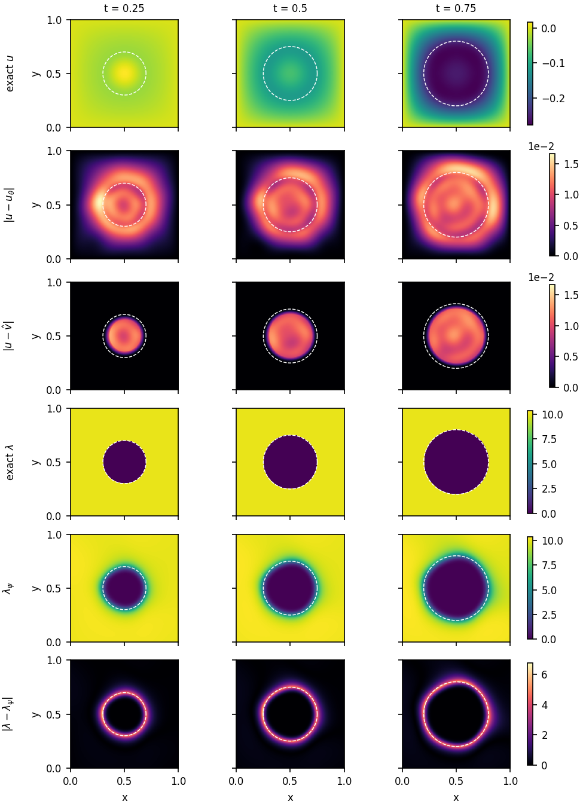

# certified-neural-obstacle

**Certified neural approximations for parabolic obstacle problems.**

This repository trains neural networks for parabolic obstacle problems and then certifies them. The certificate is a
guaranteed upper bound on the error, computed with validated (outward-rounded) arithmetic from the frozen network
alone. It does not need the exact solution or a reference solver. Every reported bound carries a status that says
exactly what kind of guarantee it is.

<p align="center">
  
</p>

*Expanding-disk benchmark (2 + 1 dimensions), trained network (seed 0) at $`t = 0.25, 0.5, 0.75`$. Rows, top to
bottom: the exact state $`u`$; the network error $`|u-u_\theta|`$; the error of the certified projected output
$`|u-\hat v|`$; the exact contact multiplier $`\lambda`$; the network multiplier $`\lambda_\psi`$; and
$`|\lambda-\lambda_\psi|`$. The dashed circle is the exact free boundary. The projection $`\hat v = \max(v,g)`$
removes the error on the contact set, so what remains sits inside the disk. The multiplier error is concentrated
on the free boundary. ([PDF](figures/disk_solution.pdf))*

---

## 1. Problem class

On the space-time cylinder $`Q = (0,T)\times\Omega`$, find the state $`u`$, the flux $`\sigma`$ and the contact
multiplier $`\lambda`$ such that

```math
\begin{aligned}
\partial_t u + \nabla_x\!\cdot\sigma + b\cdot\nabla_x u + c\,u - \lambda &= f, &
\sigma + A\nabla_x u &= 0 && \text{in } Q,\\
u \ge g,\qquad \lambda &\ge 0, & \lambda\,(u-g) &= 0 && \text{in } Q,\\
u &= 0 \ \text{on } (0,T)\times\partial\Omega, & u(0) &= u_0 .
\end{aligned}
```

Here $`g`$ is the obstacle and $`A \ge \alpha I`$ the diffusion. The constant $`\Lambda \ge c_F^2`$ (Friedrichs) is a
recorded problem parameter.

## 2. Neural triple

Admissibility is built into the architecture, never penalised:

```math
u_\theta = B(x)\,N_\theta(t,x), \qquad
\sigma_\phi = S_\phi(t,x), \qquad
\lambda_\psi = M_\psi(t,x)^2 \ \ (\ge 0 \text{ exactly}),
```

where $`B`$ vanishes on $`\partial\Omega`$ (on a box, $`B=\prod_j 4(x_j-a_j)(b_j-x_j)/(b_j-a_j)^2`$) and
$`N, S, M`$ are tanh MLPs (default 4×64). Training uses Adam followed by L-BFGS on weighted mean squares of the
residuals below, plus the complementarity term $`\operatorname{mean}(\lambda\,\gamma^-)`$.

## 3. The certificate

For a triple $`(v,\tau,\mu)`$ let $`\gamma = g - v`$ and $`w = \gamma_+`$. The residuals are

```math
R = f - \partial_t v - \nabla\!\cdot\tau - b\cdot\nabla v - c\,v + \mu, \qquad
S = A^{-1/2}\tau + A^{1/2}\nabla v .
```

The certified output is the feasible projection $`\hat v = \max(v, g) = v + w`$, with the same $`\tau, \mu`$ and
residuals $`\hat R`$, $`\hat S`$.

**Upper sums.** On a dyadic partition of $`Q`$, every term is enclosed cell by cell with first-order Taylor models
in validated arithmetic. The sums give

```math
U_R \ge \lVert \hat R\rVert^2,\quad
U_S \ge \lVert \hat S\rVert^2,\quad
U_I \ge \lVert u_0-\hat v(0)\rVert^2,\quad
U_C \ge \int_Q \mu\,(v-g)_+ .
```

**Direct bounds** (manuscript Theorem 4.10 and Corollary 4.12). With $`D = U_S + U_I + 2U_C`$ and
$`L = c_F^2\,U_R/\alpha`$:

```math
\begin{aligned}
F_{\mathrm{dir}} &= \sqrt{D+L} \;\ge\; \Big(\lVert A^{-1/2}(\sigma-\tau)\rVert^2 + \lVert e(T)\rVert^2\Big)^{1/2},\\
G_{\mathrm{dir}} &= \sqrt{L} + \sqrt{D+L} \;\ge\; \lVert A^{1/2}\nabla(u-\hat v)\rVert,\\
G_{\mathrm{AR}} &= \tfrac12\Big(a + \sqrt{a^2 + 2(U_I + 2U_C)}\Big), \qquad a = \sqrt{U_S} + \sqrt{c_F^2\,U_R}.
\end{aligned}
```

All final arithmetic is done in 192-bit Arb, and upper endpoints are rounded upward. The older estimator-based bounds
($`E_U`$ family with $`C_{\mathrm{eq}}`$, $`C_{\mathrm{rel}}`$) are kept for comparison.

**Validated lower bound of the solution scale** (v20). When no closed form for $`N = \lVert\nabla u\rVert`$ is
available, lower sums $`L_\tau \le \lVert\tau\rVert^2`$ and $`L_{\nabla\hat v} \le \lVert\nabla\hat v\rVert^2`$
give, for $`A = I`$,

```math
N \;\ge\; N_{\mathrm{lo}} = \max\Big\{\sqrt{L_\tau} - F_{\mathrm{dir}},\ \sqrt{L_{\nabla\hat v}} - G_{\mathrm{AR}}\Big\},
```

so that $`\text{bound}/N \le \text{bound}/N_{\mathrm{lo}}`$ whenever $`N_{\mathrm{lo}} > 0`$.

**Status vocabulary.** Every number carries exactly one status. A status can be demoted but is never upgraded.

| status | meaning |
|---|---|
| `validated_upper_bound` | every cell, trace cell and constant enclosed in validated arithmetic and finite; exact partition coverage; model frozen |
| `validated_lower_bound` | the same guarantees, for a lower endpoint ($`N_{\mathrm{lo}}`$ and the lower sums) |
| `unvalidated_enclosure` | an enclosure not built with validated arithmetic (global-Lipschitz baseline) |
| `diagnostic_float64` | float64 quadrature or reference-solver quantity; no guarantee |

## 4. Benchmarks

| problem | domain | exact solution | module |
|---|---|---|---|
| Stefan | $`\Omega=(0,1)`$, $`T=1`$ | closed form | `problems/stefan.py` |
| expanding disk | $`(0,1)^2`$ | closed form | `problems/disk.py` |
| off-centre ellipse | $`(0,1)^2`$ | closed form | `problems/ellipse.py` |
| rising obstacle (`rising1d`) | $`\Omega=(0,1)`$, $`T=1`$ | none; finite-difference PDAS reference (diagnostic only) | `problems/rising1d.py` |
| American put (legacy) | log-price, $`(-1,7)`$ | frozen reference | `problems/american_put.py` |

`rising1d` uses $`f = -8\sin(\pi x)`$, $`u_0 = 0`$ and $`g = -\tfrac35 + \tfrac35 t - 2(x-\tfrac12)^2`$.

## 5. Repository layout

```text
certified_obstacle_nn/            Python package
  problems/                       benchmark data and constants
  models/                         neural triple (state, flux, multiplier networks)
  training/                       losses and trainer (Adam, then L-BFGS)
  residuals/, autograd/           residuals with first derivatives only
  certification/
    enclose/                      validated engine used for all reported numbers:
                                  intervals_arb.py (Arb reference), intervals_np.py (NumPy, outward rounding),
                                  tm.py (Taylor models), engine.py / engine2d.py, boxes.py (dyadic partitions,
                                  exact coverage), upper_sum.py (upper and lower sums)
    reliability.py                constants, direct bounds, G_AR, N_lo (Arb)
    components.py                 float64 component quadrature (diagnostic)
    certificate.py, level2/       global-Lipschitz and earlier baselines (appendix only)
  errors/                         true errors from closed forms or frozen references
  experiments/                    training, certification and reference drivers (v14 ... v20)
  scripts/                        command-line tools, table builder, floating-point environment check
  tests/                          unit tests
results/                          run outputs (generated locally; only the inputs below are tracked)
```

## 6. Install and test

```bash
git clone https://github.com/DavoodDamircheli/certified-neural-obstacle.git
cd certified-neural-obstacle
python3 -m venv .venv && source .venv/bin/activate
pip install -r requirements.txt     # pinned versions used for the published results
pip install -e .
pytest -q                           # fast default run, excludes tests marked `legacy`
python3 -m certified_obstacle_nn.scripts.check_fp_env    # floating-point environment check
```

`python-flint` must be 0.9.0: the validated results depend on it. Tests that compare against stored run outputs
skip themselves when those outputs are not present (see section 8).

## 7. Worked examples

**Rising-obstacle reference solution** (about 10 s). It writes `results/v20_reference/<timestamp>/`:

```bash
python3 -m certified_obstacle_nn.experiments.v20.reference_rising1d
```

**Stefan seed 0 certificate, reproduced bit for bit.** The repository ships the Stefan seed-0 checkpoint
(`results/stefan_m18/4x64/seed0/weights.pt`) and the stored summary of its 512 × 512 certificate. This command
rebuilds the partition, recomputes every per-term sum and direct bound from the checkpoint, and compares them with
the stored values exactly:

```bash
python3 -m certified_obstacle_nn.experiments.v17.reproduce_one --backends numpy --workers 8
```

It prints `REPRODUCED` on success. Add `arb` to `--backends` to repeat it with the Arb reference backend, which is
much slower.

**Training and certifying the rising-obstacle benchmark** (protocol `results/v20_protocols/rising1d_protocol.json`):

```bash
python3 -m certified_obstacle_nn.experiments.v20.train_rising1d --seed 0 --threads 6           # ~4 min
python3 -m certified_obstacle_nn.experiments.v20.certify_rising1d --train-run results/v20_rising1d_train/<ts> \
        --n 512 1024 --workers 8
```

Each run writes a new directory `results/<experiment>/<timestamp>/` with `config.json` (seed, architecture,
schedule, grids, constants), the training history, per-cell records, a one-row `summary.csv` and `weights.pt`.
Certification never sees the training points, never changes a parameter, and runs only in float64 or validated
arithmetic.

## 8. Data

The trained checkpoints, frozen partitions and full run outputs behind the published tables (several GB) are archived
separately on Zenodo: DOI to be added. Unpacking that archive into the repository root restores the `results/`
directories that the remaining drivers and data-dependent tests read.

## 9. Citation

If you use this code, please cite it with the metadata in `CITATION.cff`. The space-time finite element framework
this project builds on is:

> J. J. Carvajal, D. Damircheli, T. Führer, F. Fuica, and M. Karkulik,
> *A space-time finite element method for parabolic obstacle problems*,
> IMA Journal of Numerical Analysis, 2026.

## License

MIT; see `LICENSE`.

## Author

**Davood Damircheli** · ORCID [0000-0003-3099-6382](https://orcid.org/0000-0003-3099-6382)
